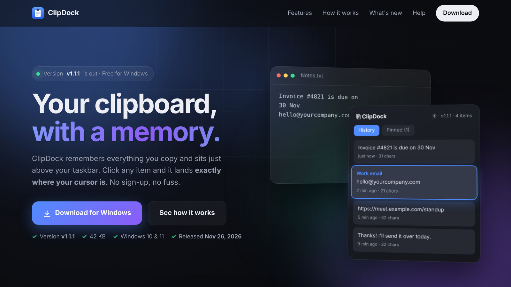
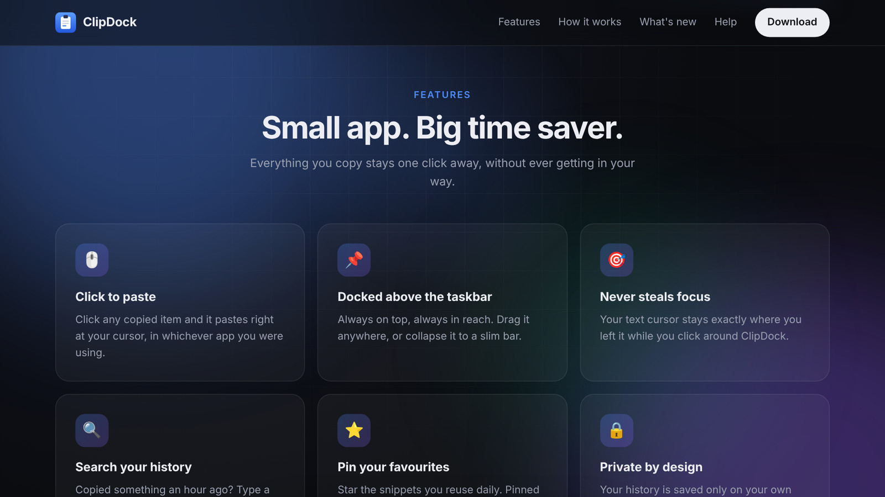

<div align="center">


# ClipDock

**Your clipboard, with a memory.**
Clipboard history that docks above your taskbar and pastes exactly where your cursor is.

<p>
  
  
  
  
  
  
</p>

[**Download**](#download) &nbsp;·&nbsp; [Features](#features) &nbsp;·&nbsp; [Install](#install) &nbsp;·&nbsp; [Update](#updating) &nbsp;·&nbsp; [Troubleshooting](#troubleshooting) &nbsp;·&nbsp; [For maintainers](#maintainers)

<br>



</div>

<br>

## ✨ What is ClipDock?

Copy something, copy something else, then realise you needed the first one. ClipDock remembers
**everything you copy** in a small always-on-top window above the Windows taskbar. Click any item
and it is pasted **right where your text cursor is**, in whichever app you were using.

No account. No cloud. No tracking. Just your clipboard, with a memory.

<div align="center">
  
</div>

<a id="features"></a>

## 🚀 Features

| | Feature | What it does |
|---|---|---|
| 🖱️ | **Click to paste** | Click an item and it lands at your cursor, in any app. |
| 📌 | **Docked above the taskbar** | Always on top and always in reach, or collapse it to a slim bar. |
| 🎯 | **Never steals focus** | Your text cursor stays exactly where you left it while you click around ClipDock. |
| ↔️ | **Move & resize freely** | Drag from *anywhere* to move it, and drag any edge or corner to resize. Size and position are remembered. |
| 🏷️ | **Name your clips** | Give any item a name like “Work email”, then find it by that name. |
| 🔍 | **Instant search** | Search by what you copied **or** by the name you gave it. |
| 🌗 | **Day & night mode** | One click switches between a light and a dark look, and ClipDock remembers it. |
| ⭐ | **Pin favourites** | Star snippets you reuse daily. Pinned items are never auto-deleted. |
| 💡 | **Hover hints** | Hover any button to see what it does. |
| 🔄 | **Update check** | A small `Update v1.x.x ↗` note appears when a new version is out. |
| 🔒 | **Private by design** | History is stored only on your PC. Nothing is uploaded. |

<div align="center">
  
</div>

<a id="download"></a>

## ⬇️ Download

Get the latest version from the website: **https://YOUR-SITE-ADDRESS** (the *Download for Windows* button).

> The download button always points to `downloads/ClipDock-latest.zip`, so it is always the newest version.
> Older versions are kept in [`downloads/`](downloads/) as `ClipDock-vX.Y.Z.zip`.

<a id="install"></a>

## ⚡ Install in about a minute

<div align="center">
  
</div>

1. **Unzip** the download (right-click → *Extract All*).
2. Double-click **`install_shortcut.bat`**. It does everything for you:
   - 🐍 **No Python? It installs it** (the official one, downloaded through the terminal window, about 1–2 minutes, no admin rights needed).
   - ♻️ **Already have ClipDock? It removes the old version first** and installs the latest in its place. Your history and settings are kept.
   - 🔗 Adds **ClipDock** to your Desktop and Start menu and starts it.
3. **Copy** as usual with `Ctrl + C`, then **click an item** to paste it at your cursor.

> **Prefer a single file?** Download [`ClipDock-Setup.bat`](downloads/ClipDock-Setup.bat). It fetches the latest ClipDock and runs the same installer (Python included).

> 💡 Right-click the ClipDock shortcut → **Pin to taskbar** for one-click launching.

### 🎮 Quick controls

| I want to… | Do this |
|---|---|
| **Paste** an item | Click it. It pastes where your text cursor is. |
| **Move** the window | Drag from any empty spot, or press-and-drag an item. |
| **Resize** the window | Drag any edge or corner. The minimum size is 300 × 260. |
| **Name** an item | Click the pencil ✎, type a name, press **Enter** (**Esc** cancels). |
| **Find** an item | Click the search box and type part of its text or its name. |
| **Pin** an item | Click the star ☆. Pinned items live under the *Pinned* tab. |
| **Switch day / night** | Click the ☀ / ☾ button in the header. |
| **Pause** capturing | Click the ● button (for example, when copying a password). |
| **Collapse** to a slim bar | Click the — button. |

<a id="updating"></a>

## 🔄 Updating

Run **`install_shortcut.bat`** from the newest zip (or **`ClipDock-Setup.bat`**) again. It **uninstalls the previous
version and installs the latest**, and your clipboard history is kept. ClipDock also checks for updates by itself;
when one is ready, an **Update ↗** note appears in its header and clicking it opens the download page.

**Uninstall:** run `uninstall_clipdock.bat` (it is in the zip and in `%LOCALAPPDATA%\ClipDock`). It asks whether to
delete your history too.

<a id="troubleshooting"></a>

## 🧰 Troubleshooting

| Problem | Fix |
|---|---|
| **Windows says a file is blocked** (Smart App Control) | Smart App Control blocks unsigned `.exe` files. ClipDock is **not** an .exe; it runs through Python, so use `install_shortcut.bat` from the zip. |
| **“Could not install Python automatically”** | You may be offline or a policy blocked the download. Install Python from [python.org](https://www.python.org/downloads/) (tick *Add python.exe to PATH*) and run the installer again. |
| **“Windows protected your PC”** | That is SmartScreen warning about any downloaded file. Click **More info → Run anyway**. The installers are plain-text `.bat` files you can read. |
| **Nothing pastes in an admin / elevated app** | Windows blocks normal programs from typing into admin windows. Start ClipDock as administrator too. |
| **I copied a password** | History (including item names) is stored in plain text on your PC. Press the **●** pause button before copying sensitive things, or use **Clear history**. |
| **The window is off-screen or the wrong size** | Close ClipDock and delete `%APPDATA%\ClipDock\settings.json`. It will reopen above the taskbar at the default size. |
| **Shortcut wasn't created** | The installer prints 4 manual steps. It takes about 30 seconds. |
| **How do I uninstall?** | Run `uninstall_clipdock.bat`. It removes the app and shortcuts, then asks whether to delete your history. |

<div align="center">
  
  <br><sub>The website works on phones, too.</sub>
</div>

---

<a id="maintainers"></a>

# 🛠 For maintainers

Everything below is for whoever publishes ClipDock. It is **not** needed to just use the app.

## 📁 Project structure

```text
ClipDock/
├── index.html · style.css · app.js    the website (no build step, no sign-up)
├── version.json · version.js          current version + changelog (written by release.py)
├── downloads/
│   ├── ClipDock-latest.zip            ← the Download button always points here
│   ├── ClipDock-Setup.bat             ← one-file online installer (built by release.py)
│   └── ClipDock-v1.0.0.zip            ← every past version is kept
├── app_source/                        ← edit the app HERE
│   ├── clipdock.pyw                   the app (Python + Tkinter, no extra packages)
│   ├── clipdock.ico                   app icon
│   ├── install_shortcut.bat           installer: adds Python if missing, replaces old versions
│   ├── uninstall_clipdock.bat         uninstaller (offers to delete history)
│   └── README.txt                     shipped inside the zip
├── tools/                             template for ClipDock-Setup.bat
├── docs/                              images used by this README
├── release.py · release.bat           publish a new version
└── README.md
```

## 📦 Publish an update (30 seconds)

1. Change the app in `app_source/clipdock.pyw`.
2. Double-click **`release.bat`** (or run the command below).
3. Commit and push to GitHub, including the new `.zip` files in `downloads/`.

```bash
python release.py 1.1.0 -n "Added dark mode" -n "Fixed a paste bug"
```

| `release.py` does | Result |
|---|---|
| Stamps the version into `clipdock.pyw` | The app shows the right version |
| Zips `app_source/` → `downloads/ClipDock-v1.1.0.zip` | A permanent copy of every release |
| Copies it to `downloads/ClipDock-latest.zip` | The website's Download button gets the new file |
| Rewrites `version.json` and `version.js` | Website version, size, date and changelog update automatically |
| Rebuilds `downloads/ClipDock-Setup.bat` | The one-file installer always fetches the newest zip |

## ☁️ Deploy on Cloudflare (free)

Cloudflare serves static files with unlimited bandwidth on the free plan.

1. In the Cloudflare dashboard go to **Workers & Pages → Create application → Import a repository** and pick this repo.
2. Use these settings:

   | Setting | Value |
   |---|---|
   | Project name | `clipdock` |
   | Build command | *(leave empty)* |
   | Deploy command | `npx wrangler deploy` *(default)* |
   | Root directory | *(blank if `index.html` is at the repo root)* |
   | Protect with Cloudflare Access | **Off**, otherwise visitors must log in |

3. Click **Deploy**. Every push to `main` now redeploys the site automatically.

<details>
<summary><b>Build failed or 404? Add a <code>wrangler.jsonc</code></b></summary>

Create this file next to `index.html`. The `name` must match the project name in the dashboard.

```jsonc
{
  "name": "clipdock",
  "compatibility_date": "2026-11-24",
  "assets": { "directory": "." }
}
```

</details>

Other free hosts also work: **GitHub Pages** (Settings → Pages → deploy from `main`) and
**Netlify Drop** (drag the folder in).

## 🔔 The in-app update check

It works out of the box: ClipDock reads `version.json` from this GitHub repo (`main` branch) and, when a newer
version exists, shows **Update v1.x.x ↗** in its header. Clicking it opens the download page.

To point it at your **website** instead, pass the address once. It is remembered for later releases:

```bash
python release.py 1.1.2 --site-url https://YOUR-SITE-ADDRESS -n "What changed"
```

That stamps the website address into the app and into `ClipDock-Setup.bat` (which tries your site first and
falls back to GitHub).

## 👀 Preview locally

Double-click `index.html`. Nothing to install or build.

## 🧱 Built with

- **App:** Python 3 + Tkinter + Win32 (`ctypes`). No third-party packages.
- **Website:** plain HTML, CSS and JavaScript, no frameworks and no build step.
- **Releases:** one Python script (`release.py`).
- **Hosting:** Cloudflare, with the repository on GitHub.

## 💬 Feedback

Found a bug or have an idea? [**Open an issue**](https://github.com/AkarshanGhosh/ClipDock/issues) and
it will go into the next release.

<div align="center">
<br>

Made with care by [@AkarshanGhosh](https://github.com/AkarshanGhosh) for people who copy a lot.

<sub>⭐ If ClipDock saves you time, star the repo.</sub>

</div>
